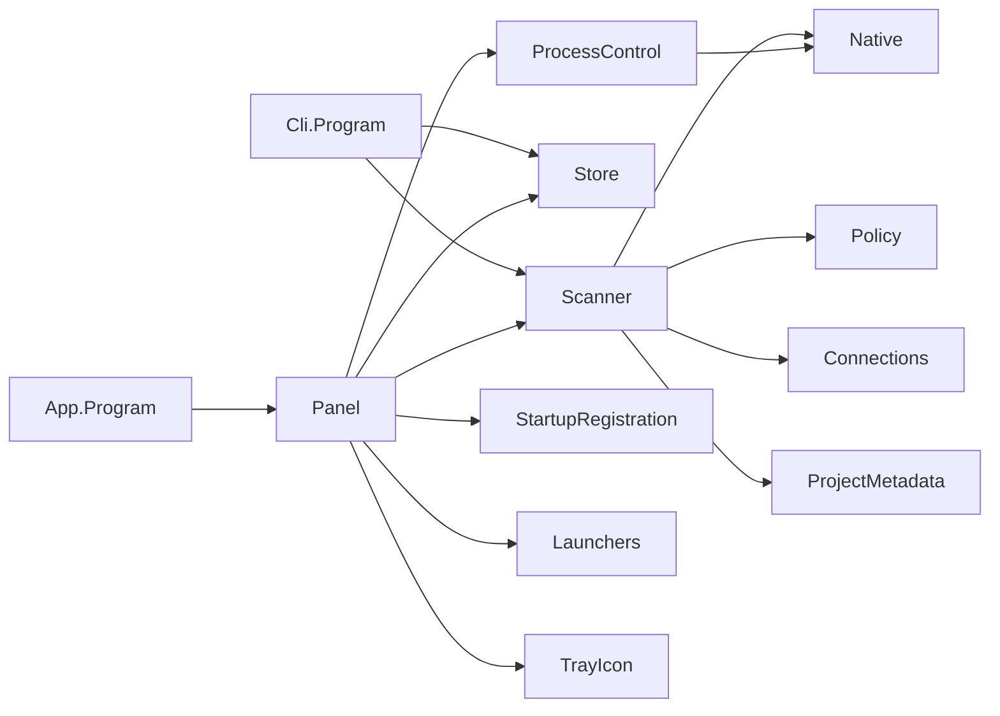
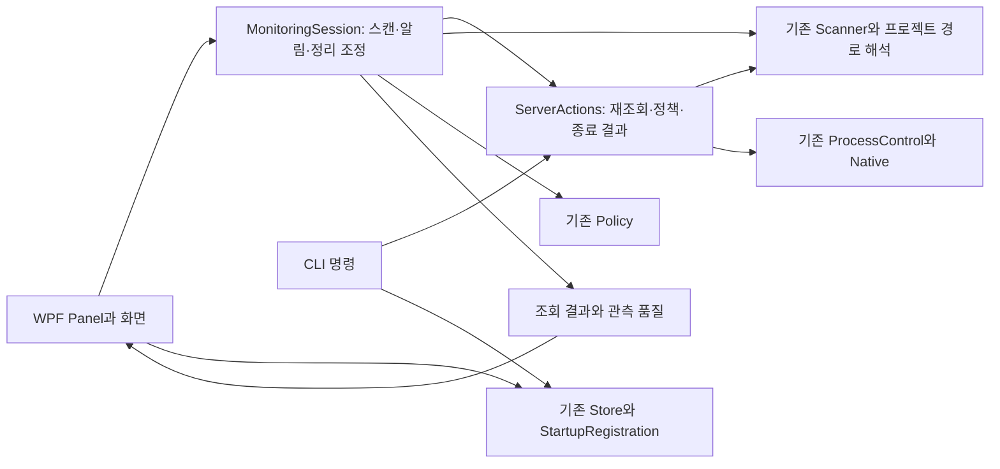

# 구조 검토와 문서 맵

검토일: 2026-11-15. 기준 커밋: `7afbe865b43826ef37e5cccdc8220d0b0b0e2534`, 앱 1.1.7.

이 저장소는 한 사용자의 Windows 개발 서버를 조회하고 선택한 프로세스를 종료하는 트레이 앱이다. 같은 Core를 사용하는 CLI와 정적 다운로드 사이트를 함께 관리한다. 가정한 규모는 GUI 한 인스턴스, 로컬 리스너 수십 개, 기본 3초 갱신이다. 별도로 동시 CLI 저장 두 건의 영향을 실험했다.

**판정:** Core·앱·CLI의 분리는 유효하고 불필요한 외부 패키지는 없다. 먼저 기존 안전 문제와 자동 실행 경로를 정리하고, 테스트 경계를 확보한 다음 `Panel`의 작업 조정을 분리하는 순서가 적절하다. 검토 당시의 판정이다. 현재 소스의 수정 결과는 다음 절에서 구분한다.

## 후속 수정 · 2026-11-16

1.1.8에서 우선 항목 **1–7과 검사 방식 11**을 수정했다. 아래 번호별 발견 사항·줄 번호는 기준 커밋의 기록으로 보존한다. 공개 EXE·ZIP도 1.1.8로 교체한다. 최종 파일의 무결성·기능 검증 기록은 docs/downloads/FUNCTIONAL-TESTS-1.1.8.json에서 구분한다.

| 범위 | 수정 |
|---|---|
| 자동 실행 | 설치 옵션도 앱의 `StartupRegistration.Set`을 호출. 새 시작프로그램 바로가기를 만들지 않는다. |
| S1 메타데이터 | [ProjectMetadata](src/Core/ProjectMetadata.cs)에 최소 경로 검증을 모음. 로컬 일반 저장소·상호 포인터가 맞는 worktree·상위 저장소 submodule만 허용. |
| S2 터미널 | 사용자 WindowsApps의 절대 실행 별칭과 시스템 PowerShell 절대 경로 사용. |
| S3 프로세스 트리 | 측정된 부모·자식의 시작 시각을 각 연결에서 비교. 잘못된 하위 트리 제외, 기존 메모리·CPU 값 보존. |
| S4 자동 정리 | 부분 관측·루트 또는 하위 프로세스의 활성 TCP 연결은 자동 정리에서 제외. 부분 관측 이후 idle 시간 재시작. CLI JSON 형식 유지. |
| S5 링크 | 구조가 잘못된 저장 항목을 안전하게 제외. 새 저장으로 손상된 원본을 덮어쓰지 않음. |
| 동시 저장 | 같은 Windows 세션·저장소에서 읽기·병합·원자 교체 전체를 이름 있는 mutex로 보호. 최대 5초 대기 뒤 오류 전달. |
| 회귀 검사 | 문제 재현을 성공으로 세던 검사를 차단 검증으로 전환. 일반·단일 EXE 테스트에 연결하고 실제 검사 대상·SHA-256 출력. |

프로젝트 폴더 조회의 메모리 읽기, 서버 종료 API, 보호 프로세스 정책은 유지했다. 새 의존성은 없다. 사용하지 않게 된 `tests/TerminalAuditFixture.cs`는 삭제했다. 터미널 검사는 실제 앱을 실행하지 않고 시작 정보의 신뢰 경로를 확인한다.

| 검증 | 2026-11-16 실제 결과 |
|---|---|
| `scripts/test.ps1` | 종료 0. Core 161·UI 217·보안 회귀 24개, CLI·설치 호출·시작·실시간 그래프 통과. |
| `scripts/test-single-file.ps1` | 종료 0. Core 161·UI 217·보안 회귀 24개, 내장 폰트·라이선스·무추출 실행·시작 통과. |
| `scripts/test-package.ps1` | 종료 0. 격리 복사본에서 패키징 29개 검사 통과. 실제 공개 파일은 변경하지 않음. |
| 기존 `StorageProbe.cs` + 새 Core | 종료 0. 40회 동시 저장에서 누락 0·예외 0. 두 별도 프로세스의 40개 갱신 보존도 Core 검사에서 통과. 실사용 발생률을 뜻하지 않음. |

로그와 재현 자료: `artifacts/verification/security-fixes-20261116/`. 로컬 실행 파일: `artifacts/single-file/WhatThePort.exe`. 실제 로그인, 외부 SMB 인증, OS PID 재사용 경주, 실시간 reparse 교체 공격, 백신 재검사는 포함하지 않는다. 임의의 외부 `--separate-git-dir`과 reparse 아래 프로젝트는 브랜치 표시가 생략될 수 있다. 이론적인 추가 방어를 위해 종료 기능이나 메모리 읽기를 제거하지 않았다.

## 현재 구조와 책임

| 경계 | 실제 파일 | 현재 책임과 판단 |
|---|---|---|
| GUI 진입·인스턴스 | [Program](src/App/Program.cs), [InstanceActivation](src/App/InstanceActivation.cs) | WPF 시작, 단일 인스턴스 이벤트, 기존 창 활성화. 이 경계는 유지한다. |
| 화면·작업 조정 | [Panel](src/App/Panel.cs) | 모든 화면 생성 외에 스캔, 자동 정리, 알림, 저장, 자동 실행 등록까지 수행한다. 가장 먼저 책임을 나눌 대상이다. |
| 표현 부품 | [Shell.xaml](src/App/Shell.xaml), [Chart](src/App/Chart.cs), [PanelPlacement](src/App/PanelPlacement.cs), [TrayIcon](src/App/TrayIcon.cs), [Strings](src/App/Strings.cs) | 스타일·차트·좌표·트레이·번역은 이미 별도 구성 요소다. 이를 다시 감싸는 계층은 필요 없다. |
| 조회 | [Scanner](src/Core/Scanner.cs), [Connections](src/Core/Connections.cs), [ProjectMetadata](src/Core/ProjectMetadata.cs) | TCP·프로세스 조회, 이력, 프로젝트/Git 해석, 연결 앱 연관을 한 번의 스캔으로 처리한다. Git 경로 검증은 ProjectMetadata로 분리했다. |
| 안전 정책·종료 | [Policy](src/Core/Policy.cs), [ProcessControl](src/Core/Scanner.cs), [Native](src/Core/Native.cs) | 정책과 실제 종료는 분리되어 있다. 다만 `ProcessControl`·`StopResult`는 `Scanner.cs` 안에 있어 조회와 종료의 파일 책임이 섞여 있다. |
| 저장·외부 실행 | [Storage](src/Core/Storage.cs), [StartupRegistration](src/Core/StartupRegistration.cs), [Launchers](src/Core/Launchers.cs) | JSON·레지스트리·터미널 실행을 담당한다. 동시 저장 잠금과 설치·앱 자동 실행의 공통 등록을 적용했다. |
| 데이터·표시 형식 | [Models](src/Core/Models.cs) | 스캔 모델, CLI 직렬화 계약과 `Format`이 같은 파일에 있다. 현재 모델 변경은 CLI 출력에도 영향을 준다. |
| CLI | [Program](src/Cli/Program.cs) | 조회와 링크 등록을 직접 Core에 전달한다. 새 호스트도 이 경계를 재사용할 수 있어야 한다. |
| 배포 | [빌드](scripts/build.ps1), [단일 EXE](scripts/build-single-file.ps1), [패키징](scripts/package.ps1), [사이트 준비](scripts/prepare-site.ps1) | 일반형·단일형·ZIP·정적 사이트가 같은 소스를 다른 형태로 배포한다. 변경 시 네 경로의 입력과 증명 정보를 맞춰야 한다. |

## 의존성 점검

| 종류 | 확인 결과 | 정리 판단 |
|---|---|---|
| NuGet·npm·기타 패키지 관리 의존성 | 매니페스트·lock 파일과 외부 패키지 import를 찾지 못했다. | 제거할 외부 패키지 0개. 새 프레임워크 도입을 정리의 전제로 삼지 않는다. |
| 앱 런타임 | .NET Framework·WPF·Windows DLL을 사용한다. 일반 GUI의 실제 참조는 WPF, System 계열과 자체 Core다. | 기능상 필요한 플랫폼 의존성이다. |
| 테스트 전용 | `System.Windows.Forms.Screen`은 물리 모니터 검사에, `System.Drawing.Icon`은 EXE 아이콘 검사에 사용한다. | 앱에서 안 쓴다는 이유로 테스트 빌드 참조를 지우면 안 된다. [실제 호출](https://github.com/seo-gali/what-the-port-win/blob/7afbe865b43826ef37e5cccdc8220d0b0b0e2534/tests/UiTests.cs#L495). |
| 웹·개발 도구 | 사이트는 정적 HTML/CSS/JS, 검사 스크립트는 Node 내장 모듈과 Chrome을 사용한다. | 앱 실행 의존성과 개발 도구를 구분한다. |
| 폰트·라이선스 | Geist·Geist Mono 및 OFL/MIT 자료를 포함한다. | 사용하는 자산과 라이선스를 함께 유지한다. |
| 프로세스 API | 메모리 읽기는 폴더 조회에, 종료 API는 서버 정리에 사용한다. | 사용자가 보존하도록 지정한 핵심 기능이다. 백신 탐지 추정만으로 제거하지 않는다. |

실제 앱·Core의 참조 어셈블리도 읽어 위 구분을 확인했다. OS/.NET 전체 CVE 대조나 백신 안전 판정은 수행하지 않았다.

## 기준 커밋의 검토 결과

### 먼저 수정할 문제

#### 1. 자동 실행 등록 방식이 앱과 설치 스크립트에서 다르다

- **역할:** [앱의 설정 저장](https://github.com/seo-gali/what-the-port-win/blob/7afbe865b43826ef37e5cccdc8220d0b0b0e2534/src/App/Panel.cs#L480)은 `StartupRegistration.Set`을 사용하지만 [설치 옵션](https://github.com/seo-gali/what-the-port-win/blob/7afbe865b43826ef37e5cccdc8220d0b0b0e2534/scripts/install.ps1#L16)은 새 시작프로그램 `.lnk`를 만든다.
- **문제:** 가이드의 `install.ps1 -StartWithWindows`를 그대로 실행하면 1.1.5에서 바꾼 레지스트리 등록 경로를 우회한다. 새 시작프로그램 바로가기를 만들지 않는다는 코딩 기준과도 상충한다.
- **최소 수정안:** 설치 스크립트의 자동 실행도 기존 `StartupRegistration`으로 모으고, 격리된 경로·레지스트리로 테스트한다. 시작 메뉴 바로가기와 로그인 시작 항목은 구분한다.
- **미룰 때:** 실행 방법에 따라 등록·해제·이전 정책이 달라진다. IObit 재탐지의 직접 원인까지 확인된 것은 아니다.

#### 2. 프로젝트 메타데이터가 읽을 파일 경로를 넓힐 수 있다 — 기존 S1

- **역할:** [ResolveProject](https://github.com/seo-gali/what-the-port-win/blob/7afbe865b43826ef37e5cccdc8220d0b0b0e2534/src/Core/Scanner.cs#L100)가 `.git`의 `gitdir:`와 `HEAD`를 읽는다.
- **문제:** 자체 프로젝트 밖의 marker 파일이 브랜치로 표시되는 것을 공개 1.1.7에서 재현했다. UNC는 경로 조합 허용만 확인했으며 원격 공유에 접속하지 않았다.
- **최소 수정안:** 메타데이터 해석을 분리하고, 허용할 로컬 경로를 정한 후 읽는다. 정상 worktree와 원격·장치 경로 처리를 각각 계약으로 남긴다.
- **미룰 때:** 비신뢰 프로젝트의 파일 배치가 자동 스캔의 파일 접근 범위를 결정한다. 자세한 전제와 한계는 [기존 S1](docs/security-audit.md#s1-git-메타데이터의-외부-경로-접근)에 있다.

#### 3. 터미널 실행 파일을 이름으로 찾는다 — 기존 S2

- **역할:** [Launchers.Terminal](https://github.com/seo-gali/what-the-port-win/blob/7afbe865b43826ef37e5cccdc8220d0b0b0e2534/src/Core/Launchers.cs#L14)이 Windows Terminal과 그 안의 PowerShell을 실행한다.
- **문제:** 자체 작업 폴더의 무해한 `wt.exe` fixture가 실행됐다. 폴더 이동 명령의 인용 처리가 올바른 것과 실행 파일 선택의 신뢰성은 별개다.
- **최소 수정안:** 검증된 실행 경로로 터미널과 중첩 셸을 선택한다. 기존 세션 ID 검증과 PowerShell 인용 처리는 유지한다.
- **미룰 때:** 프로젝트/현재 폴더의 동명 실행 파일을 원하는 터미널로 오인할 수 있다. 관리자 권한 상승을 재현한 것은 아니다.

#### 4. 하위 트리의 부모·자식 생성 순서를 각 연결에서 확인하지 않는다 — 기존 S3

- **역할:** [Policy.Visit](https://github.com/seo-gali/what-the-port-win/blob/7afbe865b43826ef37e5cccdc8220d0b0b0e2534/src/Core/Policy.cs#L22)이 PID의 부모 관계로 종료할 트리를 만든다.
- **문제:** 새 부모보다 오래된 orphan이 이전 부모 PID 때문에 편입되는 합성 그래프를 재현했다. 루트보다 오래된 프로세스만 거르는 것으로는 이 경우를 막지 못한다.
- **최소 수정안:** 이미 사용하는 PID·시작 시각으로 각 부모·자식 연결을 검증하고 불확실한 연결은 제외한다. 종료 핸들에서 하는 기존 신원 검증도 유지한다.
- **미룰 때:** 정상 트리 종료에 무관한 프로세스가 포함될 수 있다. 실제 OS PID 재사용 경주는 실행하지 않았고 수동 강제 종료의 루트 하나 제한은 별도로 유지된다.

#### 5. 부분 관측을 자동 정리 불가 상태로 표시하지 않는다 — 기존 S4

- **역할:** [Scanner](https://github.com/seo-gali/what-the-port-win/blob/7afbe865b43826ef37e5cccdc8220d0b0b0e2534/src/Core/Scanner.cs#L29)는 읽지 못한 프로세스를 건너뛰고 [CleanupCandidate](https://github.com/seo-gali/what-the-port-win/blob/7afbe865b43826ef37e5cccdc8220d0b0b0e2534/src/Core/Policy.cs#L38)는 집계 결과로 idle을 판단한다.
- **문제:** 후보 판정에 관측 완전성과 하위 연결 상태가 없다. 하위 프로세스 관측이 빠진 입력이 후보가 되는 것을 재현했다.
- **최소 수정안:** 완전·부분·실패 상태를 조회 결과에 전달하고, 부분 관측이면 자동 정리에서 제외한다. 현재 수동 확인과 종료 직전 재스캔은 유지한다.
- **미룰 때:** 일부를 보지 못한 상태를 조용한 서버로 해석할 수 있다. 장시간 실제 서버를 자동 종료하는 실험은 하지 않았다.

#### 6. 저장된 링크의 개별 레코드를 로드할 때 검증하지 않는다 — 기존 S5

- **역할:** [LoadLinks와 LinkFor](https://github.com/seo-gali/what-the-port-win/blob/7afbe865b43826ef37e5cccdc8220d0b0b0e2534/src/Core/Storage.cs#L73)가 사용자 JSON을 읽고 서버와 연결한다.
- **문제:** `Folder:null` 레코드는 로드를 통과한 뒤 `TrimEnd`에서 예외를 낸다. 자체 JSON으로 재현했다.
- **최소 수정안:** 로드 시 레코드를 검증하고 잘못된 항목의 처리·안내를 정한다. 조회도 null에 안전하게 한다.
- **미룰 때:** 링크 파일 일부 손상만으로 상세·연결 화면이 실패할 수 있고 새 스키마 도입도 어려워진다.

### 확장 전에 정리할 문제

#### 7. 원자적 파일 교체가 링크 목록 전체의 동시 갱신을 보호하지는 않는다

- **역할:** [SaveLink](https://github.com/seo-gali/what-the-port-win/blob/7afbe865b43826ef37e5cccdc8220d0b0b0e2534/src/Core/Storage.cs#L78)는 읽기→항목 변경→원자적 교체를 수행한다. GUI와 여러 CLI가 같은 파일을 사용할 수 있다.
- **문제:** 격리된 저장소에서 두 호출을 동시에 시작한 40회 모두 기대한 링크 하나 이상이 누락됐고, 16회는 예외도 발생했다. 실사용 발생률을 측정한 수치는 아니다.
- **최소 수정안:** 동시 CLI 등록이 지원 조건이면 읽기·변경·쓰기 전체의 프로세스 간 조정과 읽기 공유 모드를 함께 설계한다. 프로세스 내부 `lock`만으로 다른 CLI를 막을 수는 없다.
- **미룰 때:** 병렬 에이전트 등록으로 한쪽 링크가 조용히 사라질 수 있다. 잠금·대기·실패 처리 비용을 합의한 뒤 구현하고, 이번에는 복잡성을 추가하지 않았다.

#### 8. Panel이 화면과 작업 흐름을 함께 소유한다

- **역할:** [Refresh](https://github.com/seo-gali/what-the-port-win/blob/7afbe865b43826ef37e5cccdc8220d0b0b0e2534/src/App/Panel.cs#L204), [StopServers](https://github.com/seo-gali/what-the-port-win/blob/7afbe865b43826ef37e5cccdc8220d0b0b0e2534/src/App/Panel.cs#L396), [설정 저장](https://github.com/seo-gali/what-the-port-win/blob/7afbe865b43826ef37e5cccdc8220d0b0b0e2534/src/App/Panel.cs#L480)이 화면 생성 클래스 안에 있다.
- **문제:** 자동 정리·알림·저장 정책을 바꾸려면 WPF 상태와 함께 이해하고 테스트해야 한다. 예를 들어 정리 결과 검증도 화면·번역·트레이 갱신과 엮인다.
- **최소 수정안:** 기존 Scanner·Policy·ProcessControl은 재사용하고 작업 조정부터 분리한다. `ProcessControl`과 `StopResult`의 파일 이동은 같은 타입과 API를 유지한 별도 작은 변경으로 할 수 있다.
- **미룰 때:** 화면 추가와 CLI 기능 확장이 같은 거대한 조정 지점을 계속 수정하게 된다. 줄 수만을 이유로 분할하지 않는다.

#### 9. Core 모델이 곧 CLI JSON 계약이다

- **역할:** [Models의 DataMember](https://github.com/seo-gali/what-the-port-win/blob/7afbe865b43826ef37e5cccdc8220d0b0b0e2534/src/Core/Models.cs#L33)를 [CLI](src/Cli/Program.cs)가 `Store.Json(snapshot)`으로 출력한다.
- **문제:** 트리·상태 모델의 필드 이름이나 구조를 바꾸면 화면 내부 수정이 CLI 응답 변경으로 이어진다. 현재 CLI 검사는 전체 메모리 존재 확인 중심이다.
- **최소 수정안:** 공개할 JSON 키·의미를 계약 테스트로 고정한 뒤 모델 변경 시 작은 CLI 변환 경계를 둔다. 새 버전·래퍼를 미리 늘리지는 않는다.
- **미룰 때:** 내부 설계 변경이 스크립트와 에이전트 소비자에게 예고 없는 변경이 된다.

#### 10. UI·시작 테스트가 private 필드와 WPF 내부 구현에 결합돼 있다

- **역할:** [UiTests.Rerender](https://github.com/seo-gali/what-the-port-win/blob/7afbe865b43826ef37e5cccdc8220d0b0b0e2534/tests/UiTests.cs#L542), [StartupTests](https://github.com/seo-gali/what-the-port-win/blob/7afbe865b43826ef37e5cccdc8220d0b0b0e2534/tests/StartupTests.cs#L18)가 필드·메서드 이름을 reflection으로 찾는다. 툴팁 검사는 WPF의 비공개 서비스도 호출한다.
- **문제:** 동작을 유지하면서 `Render`를 옮기거나 `current`를 다른 객체로 분리해도 테스트가 먼저 깨진다. 실행 한 곳의 예외가 뒤의 시나리오를 건너뛸 수 있다.
- **최소 수정안:** 작업 조정의 공개 동작을 일반 테스트로 옮기고, WPF 검사는 안정된 AutomationId와 실제 사용자 결과 중심으로 남긴다. 화면 크기·포커스·보호 확인 검사는 유지한다.
- **미룰 때:** 합리적인 책임 분리와 플랫폼 내부 변화가 제품 회귀처럼 보이며 수정 비용이 커진다.

#### 11. 보안 증거 프로브가 취약점의 재현 개수에 성공을 고정한다

- **역할:** [SecurityAudit](https://github.com/seo-gali/what-the-port-win/blob/7afbe865b43826ef37e5cccdc8220d0b0b0e2534/tests/SecurityAudit.cs#L56)는 관측이 6개여야 0으로 끝난다. 일반 테스트가 아니라 과거 문제의 증거 프로브다.
- **문제:** S5 등 하나를 제대로 고치면 스크립트가 실패로 끝난다. 이를 일반 품질 게이트로 재사용하면 개선을 실패로 오해한다.
- **최소 수정안:** 증거 기록은 보존하고 각 수정 때 올바른 차단 동작을 통과 조건으로 하는 회귀 검사를 만든다. 과거 관측 수는 제품의 정상 동작 계약으로 삼지 않는다.
- **미룰 때:** 보안 수정과 테스트 통과의 의미가 반대가 된다. 현재 `test.ps1`에 이 프로브가 포함돼 있다고 주장하지 않는다.

#### 12. 빌드가 평평한 소스 폴더와 한 XAML 파일을 전제로 한다

- **역할:** [일반 빌드](https://github.com/seo-gali/what-the-port-win/blob/7afbe865b43826ef37e5cccdc8220d0b0b0e2534/scripts/build.ps1#L9)와 [단일 빌드](https://github.com/seo-gali/what-the-port-win/blob/7afbe865b43826ef37e5cccdc8220d0b0b0e2534/scripts/build-single-file.ps1#L11)는 바로 아래 C#만 수집하고 [마크업 빌드](https://github.com/seo-gali/what-the-port-win/blob/7afbe865b43826ef37e5cccdc8220d0b0b0e2534/scripts/compile-markup.proj#L8)는 `Shell.xaml` 하나를 지정한다.
- **문제:** `Views/`·`Services/`에 파일을 옮기는 설계안을 그대로 실행하면 입력에서 빠진다. 폴더만 나눈다고 빌드가 따라오지는 않는다.
- **최소 수정안:** 첫 분리는 기존 평면 구조에서 한다. 하위 폴더·다중 XAML이 실제로 필요할 때 두 배포 형식의 입력 규칙과 테스트를 함께 바꾼다.
- **미룰 때:** 설계 문서대로 파일을 옮긴 뒤 일반형 또는 단일형만 빌드되는 문제가 생긴다.

#### 13. ZIP 문서가 사용자를 위한 묶음으로 관리되지 않는다

- **역할:** [build.ps1](https://github.com/seo-gali/what-the-port-win/blob/7afbe865b43826ef37e5cccdc8220d0b0b0e2534/scripts/build.ps1#L38)와 [package.ps1](https://github.com/seo-gali/what-the-port-win/blob/7afbe865b43826ef37e5cccdc8220d0b0b0e2534/scripts/package.ps1#L36)이 `docs/*.md`를 모두 복사한다.
- **문제:** 실제 공개 ZIP에 개발용 `publishing.md`·`api-design.md`는 있지만, 그 안에서 참조하는 루트 `CODING_STANDARDS.md`와 `docs/downloads` 보고서는 없다. 개발 문서를 늘릴수록 사용자 ZIP도 자동으로 늘어난다.
- **최소 수정안:** 사용자용 문서 목록과 개발·검증 기록을 구분하고 오프라인 링크 계약을 검사한다. 이번 구조 문서는 이 문제를 늘리지 않도록 저장소 루트에 둔다.
- **미룰 때:** 문서 정리가 배포 구성까지 뜻하지 않게 바꾸고 ZIP에서 열 수 없는 안내가 계속 생긴다.

#### 14. 사이트 준비가 모든 배포 증명과 표시 버전을 동기화하지 않는다

- **역할:** [prepare-site.ps1](scripts/prepare-site.ps1)은 EXE·ZIP·무결성 정보·체크섬과 HTML의 저장 이름을 갱신한다.
- **문제:** 새 바이너리로 실행해도 `ANTIVIRUS-INFO.json`, README의 현재 버전·검사 안내와 HTML의 표시 버전을 모두 맞추지는 않는다. 현재 1.1.7 자료는 일치하지만 다음 교체는 수동 작업에 의존한다.
- **최소 수정안:** 기존 EXE/ZIP 정보의 실제 버전·해시와 표시·검사 기록의 일치를 게시 전 검사한다. 검사 대상 해시가 바뀌면 과거 기록을 보존하고 새 파일은 `NotScanned`로 구분한다.
- **미룰 때:** 새 파일 옆에 이전 파일의 판정이나 버전이 남을 수 있다. 자동 백신 업로드나 새 manifest 체계가 필요한 것은 아니다.

### 작은 정리 후보

#### 15. 현재 호출자가 없는 이전 인스턴스 활성화 함수가 남아 있다

- **역할:** [Native.SignalExisting](https://github.com/seo-gali/what-the-port-win/blob/7afbe865b43826ef37e5cccdc8220d0b0b0e2534/src/Core/Native.cs#L185)은 창 메시지를 보내지만 현재 진입점은 이벤트와 `InstanceActivation`을 사용한다.
- **문제:** 소스·테스트·스크립트·문서 전체 참조 검색에서 호출자를 찾지 못했다. 새 활성화 동작을 이 함수에서 수정해도 실제 경로는 바뀌지 않는다.
- **최소 수정안:** 외부 메시지 호환성 필요 여부를 결정한 뒤 함수와 전용 `PostMessage` 선언을 제거한다. `Panel`의 메시지 수신까지 자동으로 없애지는 않는다.
- **미룰 때:** 유지보수자가 이전 경로를 현재 경로로 오해한다. 이번 검토에서는 앱 코드를 삭제하지 않았다.

## 테스트를 유지할 것과 바꿀 것

| 유지할 계약 | 구현 변경과 분리할 부분 |
|---|---|
| 같은 핸들에서 PID·시작 시각·사용자·세션·critical 상태 재검증 | Panel의 private 필드 이름과 메서드 위치 |
| 일반·자동 정리의 보호, 강제 종료의 정확한 포트 확인·루트 한 개 제한 | 모든 작업 시나리오를 하나의 WPF 실행 순서에 두는 구성 |
| 등록 취소·실패 시 복원, 격리된 레지스트리 사용 | WPF 비공개 툴팁 서비스 구현 이름 |
| 키보드·화면 크기·포커스·접근성 이름 | 업무 정책을 확인하기 위해 화면 트리를 직접 만드는 방식 |
| CLI 명령·종료 코드·JSON 의미, EXE/ZIP 해시·내장 리소스 | 취약점 6개 관측을 영구적인 성공 조건으로 쓰는 방식 |

현재의 단순한 assert 기반 실행기를 유지해도 된다. 테스트 프레임워크를 바꾸는 것보다 `Policy`의 순수 함수와 `ProcessControl.StopNode` 같은 기존 시험 경계를 먼저 활용한다. 동시 저장은 별도 프로세스까지 포함한 계약이므로 스레드 내부 잠금만 검증해서 완료로 처리하지 않는다.

## 확장 설계 제안

### 목표 구조

같은 프로세스·같은 Core 어셈블리를 유지하고 작업 조정 경계를 만든다. WPF 화면을 알지 못하는 `MonitoringSession`과 `ServerActions`는 제안 이름이며 아직 구현하지 않았다.

- **MonitoringSession:** 같은 Scanner에 대한 작업 순서, 최신 조회, 경고 억제·자동 정리 판단을 조정한다. WPF 컨트롤과 번역된 문장을 소유하지 않는다.
- **ServerActions:** 현재 `Panel.StopServers` 안의 재스캔→대상 동일성→정책 재확인→종료→재조회 흐름을 담당한다. 새 호스트도 같은 안전 경계를 사용한다.
- **Panel:** 화면 이동, 기존 `SettingsDraft`·`ViewBookmark`, 사용자 확인과 결과 표현을 맡는다. 초기에 작은 화면 생성 함수를 분리하고 전체 XAML 교체는 뒤로 둔다.
- **Scanner:** 먼저 신뢰 경로 해석과 관측 품질을 정리한다. PID·시작 시각을 버리지 않으며 메모리 읽기와 종료 기능을 제거하지 않는다.
- **Store:** 읽기 유효성과 원자적 파일 교체를 유지한다. 동시 쓰기를 지원할 때는 한 번의 변경 연산 전체에 대한 경계를 정한다.
- **CLI:** 현재 JSON 계약을 유지하는 변환 경계를 둔다. 내부 상태·오류를 enum/구조화된 이유로 바꿀 때도 기존 출력의 의미가 조용히 변하지 않게 한다.

화면과 표시 데이터의 점진적 분리에는 WPF 기본 Binding을 사용할 수 있다. 이는 UI와 데이터의 분리를 지원하는 플랫폼 기능이며 새 MVVM 패키지를 전제로 하지 않는다. [Microsoft WPF 데이터 바인딩](https://learn.microsoft.com/en-us/dotnet/desktop/wpf/data/). 백그라운드 스캔과 UI 갱신의 스레드 경계도 유지한다. [Microsoft WPF 스레딩 모델](https://learn.microsoft.com/en-us/dotnet/desktop/wpf/advanced/threading-model).

### 적용 순서와 완료 조건

| 단계 | 최소 작업 | 완료 조건 |
|---|---|---|
| 0. 안전·계약 | 1–6의 실제 문제 수정, 설치 자동 실행 통일. 동시 등록을 지원한다면 7의 처리 범위·대기 비용 합의. | 안전한 동작을 통과 조건으로 하는 회귀 검사. 기존 프로세스 보호·설정 보존 유지. |
| 1. 변경 경계 확보 | CLI JSON·저장 데이터·종료 결과 계약 검사, UI private 접근 축소. | 내부 메서드 이동이 계약 검사를 깨뜨리지 않고 잘못된 종료·출력 변경은 실패함. |
| 2. 작업 조정 분리 | 재조회·종료와 스캔/알림 조정을 기존 평면 C# 구조에서 추출. | 같은 fixture에서 결과 동일. Core가 WPF를 참조하지 않음. 두 배포 형식 통과. |
| 3. 화면 분리 | 가장 자주 수정하는 설정 또는 목록부터 Binding/뷰 생성 책임 분리. | 미저장 입력·스크롤·포커스·차트·한국어/영어 동작 유지. |
| 4. 두 번째 조회 대상 | WSL·Docker 등 실제 요청이 생길 때 공급자 계약 도입. | 조회 신원·관측 품질·종료 가능 범위를 해당 공급자 기준으로 검증. Windows PID를 원격 자원 ID처럼 사용하지 않음. |
| 5. 배포 정합성 | 기존 준비 스크립트에 표시·파일·검사 정보 일치 검사, 사용자 문서 목록 지정. | 최종 파일과 모든 해시·버전·검사 범위가 일치하고 오프라인 문서 링크가 유효함. |

지금 새 인터페이스 묶음, DI 컨테이너, 이벤트 버스, DB, HTTP 서버, 프레임워크 이전을 시작할 근거는 없다. 두 번째 구현이 실제로 필요할 때 인터페이스를 도입하고, 새 의존성·저장 방식·배포는 기존 승인 경계를 따른다. 추측적 경주를 막기 위한 복잡성은 추가하지 않는다.

## 문서 맵

| 읽을 목적 | 기준 문서 | 상태 |
|---|---|---|
| 처음 실행·기능·지원 범위 | [README](README.md), [사용 가이드](docs/usage.md), [웹 가이드](docs/guide.html) | 현재 사용자 안내. Markdown과 HTML은 대상이 달라 무조건 합치지 않는다. |
| 코드 변경·안전·승인·검증 | [AGENTS](AGENTS.md), [코딩 기준](CODING_STANDARDS.md) | 현재 개발 기준. |
| 화면·상호작용 | [디자인](DESIGN.md), [수동 체크리스트](docs/checklist.md) | 현재 화면 계약과 수동 검증 항목. 체크리스트는 통과 기록이 아니다. |
| 빌드·배포·검색 노출 | [게시 안내](docs/publishing.md), [변경 기록](CHANGELOG.md) | 현재 절차. Release 게시와 사이트 푸시는 구분한다. |
| 다운로드의 파일별 상태 | [보안 점검 이력](docs/download-security.md), [EXE 정보](docs/downloads/EXE-INFO.json), [현재 검사 상태](docs/downloads/ANTIVIRUS-INFO.json), [체크섬](docs/downloads/SHA256SUMS.txt) | 파일·버전·검사 시점을 확인한다. 과거 결과를 새 해시에 적용하지 않는다. |
| 보안 발견과 수정 상태 | [보안 검수](docs/security-audit.md) | 과거 1.1.7 재현과 1.1.8 수정을 구분한다. 과거 줄 번호는 당시 코드 기준이다. |
| 접근성·Google 검수 | [접근성 기록](docs/accessibility-audit.md), [Google 다운로드 기록](docs/google-download-audit.md) | 날짜가 있는 과거 증거. 현재 버전의 인증·검사 결과가 아니다. |
| 성능 | [성능 기준](docs/performance.md), [측정 이력](docs/resource-usage.md) | 방법과 과거 수치를 구분. 새 성능 보장은 재측정이 필요하다. |
| HTTP API·검색 기능의 향후 작업 | [API 기준](docs/api-design.md) | 조건부 작업 지침. 현재 앱에 HTTP API·DB가 있다는 뜻이 아니다. |
| ZIP 사용 | [포터블 안내 원본](assets/portable-README.md) | 패키징 시 ZIP의 README가 된다. 저장소 README와 목적이 다르다. |
| 과거 버전·실행 증거 | `docs/downloads/*-<버전>.json`, `artifacts/security`, `artifacts/verification`, `artifacts/decisions`, `artifacts/release-v*` | 증거·첨부 파일. 캐시로 간주해 지우지 않는다. artifacts는 Git 비추적이다. |

### 발견한 문서·코드 상충과 정리

- 앱 설정의 자동 실행을 `.lnk` 등록으로 설명하던 체크리스트를 현재 사용자 Run 등록으로 수정하고, 제거 안내에도 앱 설정에서 등록을 해제하는 단계를 넣었다.
- 보호 서버를 모두 종료 불가로 설명하던 사용 가이드를 일반·자동 정리 제외와 허용된 수동 강제 종료로 구분했다.
- 설치 `-StartWithWindows`의 새 시작프로그램 `.lnk` 생성은 코딩 기준과 달랐다. 후속 수정에서 기존 앱과 같은 Run 등록 함수로 통일했고 안내도 맞췄다.
- 사용 가이드의 온라인 배포 없음 설명을 단일 EXE·ZIP 제공과 미서명·자동 업데이트 없음으로 구분했다.
- 상세 연결 진입의 이전 긴 버튼 이름을 현재 `연결` 버튼 기준으로 바꿨다.
- ZIP 안내의 하단 갱신 주기 표시를 현재 설정에서 확인하도록 수정했다.
- ZIP 안내의 Esc는 항상 숨김이라는 설명을 화면 뒤로 가기·목록에서 숨김으로 수정했다.
- 미등록 A·미리보기 버튼이 안내를 띄운다는 설명을 현재 버튼 숨김과 연결 등록 방식으로 수정했다.
- 과거 접근성·Google·성능 자료에는 시점 표시를 보강했다. 당시 수치·해시·발견 사항은 덮어쓰지 않았다.

문서는 이동·삭제하지 않아 기존 경로·앵커와 패키징 호출을 보존했다. 새 검토 문서는 `docs/*.md` 자동 복사에 들어가지 않도록 루트에 배치했다. 삭제한 것은 부정확한 설명과 구형 권장 명령이며 최초 검토에서는 앱 코드·배포 파일을 수정하지 않았으며, 후속 소스 수정은 위 절에 따로 기록했다.

## 최초 검토의 실행 검증과 한계

| 실행 | 실제 결과 | 범위 |
|---|---|---|
| `powershell -NoProfile -ExecutionPolicy Bypass -File scripts/test.ps1` | 2026-11-11, 종료 0. Core 148개·UI 217개, CLI·시작·실시간 차트 검사 통과. | 생성된 일반 빌드. 2026-11-15 기준 앱 소스 변경 없음. |
| `powershell -NoProfile -ExecutionPolicy Bypass -File scripts/security-audit.ps1 -SingleFile` | 2026-11-11, 종료 0. S1–S5의 증거 6개 관측. | 공개 1.1.7 EXE. **문제 재현 성공이며 보안 통과가 아님.** |
| `StorageProbe.cs`의 격리된 두 동시 `Store.SaveLink` 호출 | 2026-11-15, 40회 중 링크 누락 40회·예외 16회. | 자체 fixture, 실사용 빈도나 다른 장치의 확률이 아님. |
| `node artifacts/verification/repo-review-20261115/check-docs.cjs` 및 `git diff --check` | 문서 9개·상대 링크 104개·앵커/소스 참조 31개, 종료 0. | 과거 증거 본문·앱 코드·공개 EXE/ZIP·표지 보존도 확인. |
| 실제 어셈블리 참조·ZIP 구성 조회 | 앱 런타임과 테스트 참조를 구분, 개발 문서의 누락된 상대 링크 확인. | 실행 메타데이터와 압축 항목만 읽음. |

원시 로그·동시 저장 프로브 소스/결과는 `artifacts/verification/repo-review-20261111`과 `artifacts/verification/repo-review-20261115`에 보존한다. 문서 변경 후 상대 경로·앵커와 명령을 검사한다.

검토는 진입점, 전체 Core의 주요 흐름, Panel의 조회·종료·설정·수명 경로, 테스트 결합과 빌드·패키징 경로에 집중했다. 모든 번역 문자열·CSS/HTML·그리기/DPI 계산식과 모든 테스트 fixture를 줄마다 검수한 것은 아니다. 실제 SMB 인증, OS PID 재사용, 장시간 자동 정리, 실제 로그인·보조공학 조합, 최신 CVE·공인 서명·백신 판정은 확인하지 않았다. 최초 문서 검토에서는 코드 변경이 없어 단일 EXE 전체 검사·사이트 브라우저·성능 측정을 반복하지 않았다. 후속 수정 검증은 위 절을 따른다.

**정리 가능량:** 호출자 없는 이전 활성화 함수와 전용 선언 약 6줄이 삭제 후보이며, 제거할 외부 패키지는 0개다. 실제 코드는 보존했다.