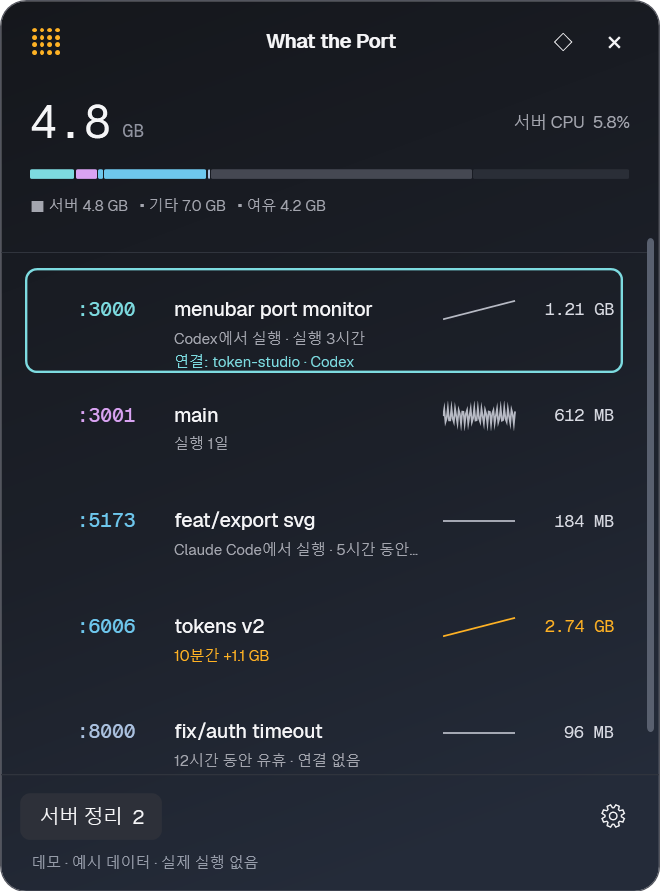
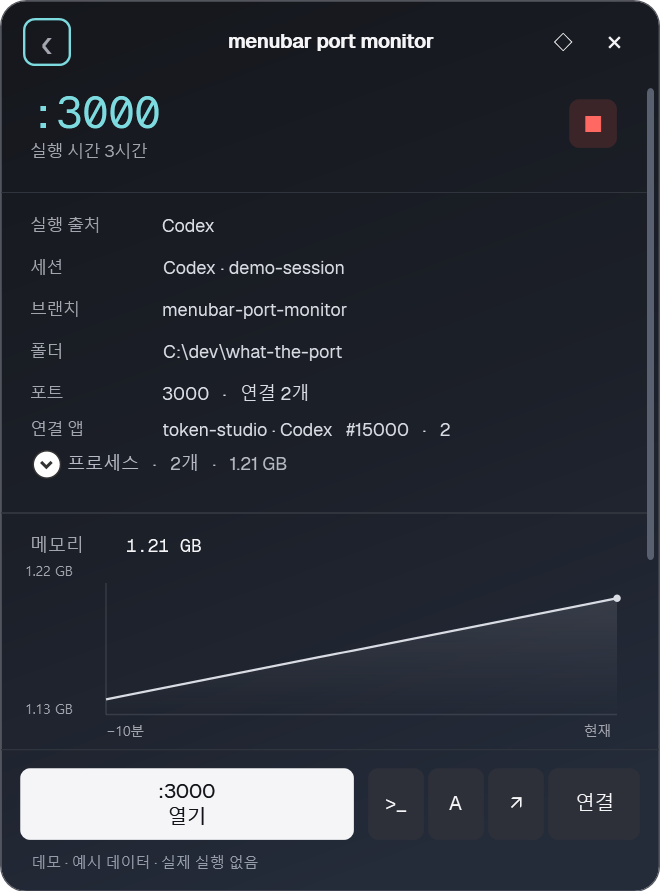
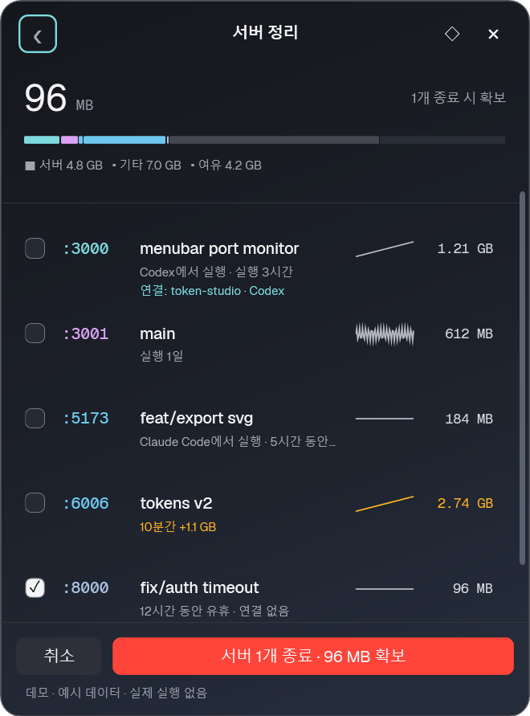

# What the Port for Windows

Windows 트레이에서 개발 서버의 포트·메모리·CPU를 확인하고, 작업이 끝난 서버를 선택해 종료합니다.

**[웹사이트 ↗](https://seo-gali.github.io/what-the-port-win/index.html)** · **[다운로드](https://seo-gali.github.io/what-the-port-win/index.html#download)** · [사용 가이드](https://seo-gali.github.io/what-the-port-win/guide.html) · [변경 기록](CHANGELOG.md)

[](https://seo-gali.github.io/what-the-port-win/index.html)

## 앱 화면

<table>
  <tr>
    <th>서버 목록</th>
    <th>서버 상세</th>
    <th>서버 정리</th>
  </tr>
  <tr>
    <td><a href="docs/images/list.png"></a></td>
    <td><a href="docs/images/detail.png"></a></td>
    <td><a href="docs/images/cleanup.png"></a></td>
  </tr>
  <tr>
    <td>실행 중인 프로젝트와 자원 사용량 확인</td>
    <td>폴더·브랜치·프로세스·그래프 확인</td>
    <td>보호 대상을 제외하고 필요한 서버만 종료</td>
  </tr>
</table>

실제 Windows 앱의 데모 화면입니다. 이미지를 누르면 크게 볼 수 있습니다.

## 할 수 있는 일

- **서버 상태 확인** — 포트·프로젝트·연결 앱과 최근 10분의 메모리·CPU 추이를 확인합니다. 사용량이 설정한 기준을 넘으면 알립니다.
- **프로젝트로 돌아가기** — 로컬 페이지나 터미널을 열고, 등록한 Codex·Claude Code 세션과 Vercel 미리보기를 실행합니다.
- **서버 정리** — 종료할 서버와 예상 회수 메모리를 확인합니다. 셸·에이전트·시스템·데이터베이스 등은 보호하며, 자동 정리는 기본 꺼짐입니다.
- **작업 환경에 맞추기** — 창 모서리를 드래그해 크기를 바꾸고, 설정에서 글꼴 크기(80–125%)·배경 불투명도·언어를 선택합니다. 화면과 그래프 갱신은 즉시 반영합니다.

설정과 연결 정보는 PC에 저장합니다. 텔레메트리·자동 업데이트·앱 자체의 외부 네트워크 요청은 없습니다.

## 시작하기

**Windows 10/11 · x64 · .NET Framework 4.8**

1. [웹사이트에서 EXE를 다운로드](https://seo-gali.github.io/what-the-port-win/index.html#download)하고 실행합니다. 설치나 압축 해제가 필요 없습니다.
2. 개발 서버를 실행한 뒤 **Ctrl+Alt+P** 또는 트레이 아이콘으로 목록을 엽니다.
3. 서버를 눌러 상세를 확인하거나 **서버 정리**에서 종료 대상을 선택합니다.

현재는 **코드 서명이 없는 시험 빌드**입니다. 다운로드 경고와 검사 결과는 [보안 안내](docs/download-security.md)에 기록되어 있습니다. 서버 종료는 즉시 적용되며 저장되지 않은 작업은 유실될 수 있습니다.

업데이트할 때는 트레이 메뉴의 **앱 종료**로 기존 앱을 닫고 새 EXE를 실행합니다. 터미널 조회가 필요하면 [CLI 포함 ZIP](https://seo-gali.github.io/what-the-port-win/downloads/WhatThePort-Windows-x64.zip)을 폴더째 풀어 사용하세요. [자세한 사용법 →](https://seo-gali.github.io/what-the-port-win/guide.html)

## 개발 및 기여

C# · WPF · .NET Framework 4.8. Windows 내장 빌드 도구를 사용하며 외부 패키지 다운로드는 없습니다.

```powershell
powershell -NoProfile -ExecutionPolicy Bypass -File scripts/build.ps1
.\dist\WhatThePort.exe --demo
```

<details>
<summary>검증·패키징 명령</summary>

```powershell
powershell -NoProfile -ExecutionPolicy Bypass -File scripts/test.ps1
powershell -NoProfile -ExecutionPolicy Bypass -File scripts/test-single-file.ps1
powershell -NoProfile -ExecutionPolicy Bypass -File scripts/test-package.ps1
powershell -NoProfile -ExecutionPolicy Bypass -File scripts/package.ps1
```

ZIP 생성 위치: `artifacts/WhatThePort-Windows-x64.zip`. CLI·문서·폰트·라이선스를 포함합니다.

</details>

[코딩 기준](CODING_STANDARDS.md) · [디자인](DESIGN.md) · [게시 절차](docs/publishing.md) · [보안 검수](docs/security-audit.md)

## 지원 범위

동일 사용자·로그인 세션의 Windows 네이티브 TCP 서버를 조회합니다. UDP·WSL·Docker 내부 자원·ARM64는 지원·검증 범위에 포함하지 않습니다. 공유 메모리와 조회 간격에 따른 측정 오차가 있습니다.

외부 프로젝트 메타데이터·실행 파일 탐색 등 미해결 항목은 [보안 검수 보고서](docs/security-audit.md), 환경별 검증 한계는 [사용 가이드](https://seo-gali.github.io/what-the-port-win/guide.html#help)를 확인하세요.

## 라이선스

[Tomjohn Design의 WhatThePort](https://github.com/tomjohndesign/what-the-port)를 기반으로 한 비공식 Windows 이식입니다. [MIT](LICENSE) · 원본 © 2026 Tomjohn Design LLC.

Geist·Geist Mono: [SIL Open Font License](assets/fonts/OFL.txt). 상단 표지는 소개용 생성 일러스트입니다.
